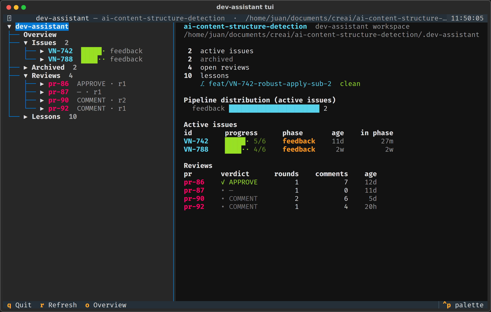

# dev-assistant

[](#project-status)
[](pyproject.toml)
[](LICENSE)

> 🚧 **Alpha — APIs, CLI flags, and slash-command behavior may change without notice.**
> Single-user origin, now opening up to invited collaborators for feedback. Not for production use.

An AI-powered developer assistant. Standardizes how dev work moves through five stages: **gather → plan → execute → feedback → evaluate**, with an optional **refine** phase 0 for tickets that arrive too thin. Two layers: a Python CLI for deterministic helpers, and Claude Code slash commands that drive the reasoning per phase.

**New here? Start with the [User guide](docs/user-guide.md)** — setup, a safe experimental-mode dry run, the full lifecycle walkthrough, concepts, and troubleshooting. See [DESIGN.md](DESIGN.md) for the architecture and rationale, and [IDEAS.md](IDEAS.md) for the deferred / next-up list.

## Quick start

```bash
# In any repo you want to use the assistant in:
dev-assistant init --with-context CONTRIBUTING.md  # optional: point at repo rules docs

# Wire the slash commands into this repo (creates a symlink in .claude/commands/)
dev-assistant commands install

# Create an issue workspace
dev-assistant issue create --id PROJ-123 --title "Refactor payments"
```

Then in Claude Code, walk the phases:

```
/dev-refine PROJ-123     # optional phase 0: think a thin ticket through (feasibility,
                         # alternatives), rewrite it in Jira → refinement/report.md
/dev-gather PROJ-123     # collect context → gathering/objectives.md
/dev-plan PROJ-123       # decompose into subtasks → plan/plan.md
/dev-execute PROJ-123    # implement one subtask per invocation; wrap-up opens the PR
                         # (in sub-branches mode, each subtask opens its own sub-PR)
/dev-feedback PROJ-123   # one round of PR review iteration per invocation
                         # (add a subtask number to target that subtask's sub-PR)
/dev-merge PROJ-123      # close the review phase: readiness checks, merge commit
                         # titled "[TICKET] ... (#PR)", branch cleanup
/dev-evaluate PROJ-123   # retro + lessons + close out externally
```

**How much code the phases write** is bounded by the `code-economy` strategy: subtasks are sized in bands (S ≤50 added lines / M ≤150 / L ≤400), each commit is measured before it lands (`dev-assistant issue size`), an over-budget diff is trimmed automatically before you're asked anything, and wrap-up runs a reduction pass over the issue's whole diff. Deletions are never charged, and readability is a cost too — clever compression is flagged exactly like bloat.

**How much the phases ask you** is set at `issue create` time with `--autonomy`: `guided` fires every checkpoint (~75 stops across a full issue), `balanced` (the default) collapses each phase's approvals into one checkpoint and its external operations into one batched confirmation (~20), and `auto` drops the approval checkpoints and records the decisions in the phase reports (~12). Questions only you can answer, external writes, and escalations are asked at every level — see [Autonomy](docs/user-guide.md#autonomy-how-much-the-phases-ask-you) and the full [interaction map](docs/interaction-map.md).

For experimental / sandbox work, add `--experimental` at `issue create` time to skip all external operations (no Jira, no GitHub, no PR) — this is also the recommended way to [try the workflow for the first time](docs/user-guide.md#4-try-it-first-with-experimental-mode-no-remote-changes).

Full walkthrough of every phase — what you're asked, what lands on disk — in the [User guide](docs/user-guide.md#5-the-lifecycle-end-to-end).

`init` adds `.dev-assistant/` to the target repo's `.git/info/exclude` so the workspace folder is never committed.

## How it works

Seven phase commands (refine is optional), each producing artifacts under `.dev-assistant/issues/<id>/`:

| Phase | Slash command | Primary outputs |
|---|---|---|
| Refine *(optional)* | `/dev-refine` | Rewritten Jira title + description (applied only after approval), `refinement/report.md` recording the feasibility/alternatives exploration |
| Gather | `/dev-gather` | `gathering/report.md`, `gathering/objectives.md` |
| Plan | `/dev-plan` | `plan/plan.md`, `plan/report.md` |
| Execute | `/dev-execute` | Code commits, PR (one subtask per invocation, then wrap-up). Big issues can opt into **sub-branches mode** at plan time: one sub-branch + sub-PR per subtask, parent PR at wrap-up |
| Feedback | `/dev-feedback` | One round of PR review iteration per invocation (main PR or a subtask's sub-PR) |
| Merge | `/dev-merge` | Explicit close of the review phase: merge-readiness checks against live GitHub state, merge **commit** (subject `[TICKET] … (#PR)` — squash is never used, so commit SHAs referenced in artifacts stay valid), branch cleanup, `merge/report.md`. Hotfix issues walk both PRs (`uat`, then the `develop` sync) |
| Evaluate | `/dev-evaluate` | Retro + lessons (categorized, deduplicated, indexed under `.dev-assistant/lessons/`) + close-out + optional non-destructive archive |

Customizable per repo via `dev-assistant strategies customize <name>` for branching, PR template, comment style, etc. Repo-owned rules documents are pointed at via `.dev-assistant/repo-context.md` and re-read on every phase invocation so the source of truth stays in the target repo.

## Terminal dashboard (experimental)

A read-only terminal UI for browsing a repo's `.dev-assistant/` workspace — issues, phases, subtasks, review rounds, and lessons — without leaving the terminal. It introspects the artifacts on disk plus live git/PR state; it never writes anything.



```bash
# Requires the optional [tui] extra (Textual):
pipx install -e '/path/to/this/repo[tui]'        # or: python3 -m pip install --user -e ".[tui]"

dev-assistant tui                  # discovers .dev-assistant/ in the current dir or a parent
dev-assistant tui --path /some/repo
```

A navigation tree (Overview / Issues / Reviews / Lessons) drills down through phases → subtasks/sub-branches → rounds → artifact files. The detail pane shows workspace rollups and a pipeline distribution chart, a per-issue timeline (phases with state dots), a status panel (branch, sub-branches, PR publish state, GitHub issue link, commits from `plan.md` + live git), review breakdowns, and a raw markdown viewer for individual artifacts. Output is monochrome (no emoji). Experimental and read-only — it's a viewer, not a controller.

## Install

Requires Python ≥ 3.10.

### Recommended: pipx (when available)

```bash
pipx install -e /path/to/this/repo
```

The `-e` flag makes it an editable install — edits to the source apply immediately, no reinstall needed.

### On Debian/Ubuntu without pipx

If `pipx` isn't installed and `apt install pipx` isn't an option right now, you can install at user level with pip directly. Because Debian/Ubuntu mark the system Python as externally-managed (PEP 668), you'll need `--break-system-packages`. This only affects your user site, not system Python:

```bash
# One-time pip bootstrap if pip isn't available either
curl -sS https://bootstrap.pypa.io/get-pip.py | python3 - --user --break-system-packages

# Install dev-assistant editable
python3 -m pip install --user --break-system-packages -e /path/to/this/repo
```

Make sure `~/.local/bin` is on your `PATH` (it usually is on modern Ubuntu).

### Development install

For contributors — installs the `[dev]` extras (pytest, ruff, build):

```bash
python3 -m pip install --user -e ".[dev]"
```

## Project status

This project is in **alpha** (`0.x`). Treat it as a working prototype, not a stable tool. Specifically:

- **No backwards-compatibility guarantees.** Flags, command names, and on-disk artifacts may change between minor versions.
- **Single-user origins.** Battle-tested for one developer's workflow. Edge cases for team scenarios are not yet handled.
- **Local-only.** No telemetry, no remote services owned by this project. External calls (Jira, GitHub) go through your existing credentials.
- **License pending.** See [LICENSE](LICENSE). Currently all rights reserved; a formal license will be added in a future release.

What's next: see [IDEAS.md](IDEAS.md) and the open issues.

## Contributing

External contributors welcome — see [CONTRIBUTING.md](CONTRIBUTING.md) for setup, dev commands, and PR conventions. Please read the [Code of Conduct](CODE_OF_CONDUCT.md) before participating.

To report a security concern privately, see [SECURITY.md](SECURITY.md).

## Releases

See [CHANGELOG.md](CHANGELOG.md) for the version history and what landed in each release.

## License

See [LICENSE](LICENSE). Currently no license is granted; the repository is shared in alpha for evaluation by invited collaborators only.
